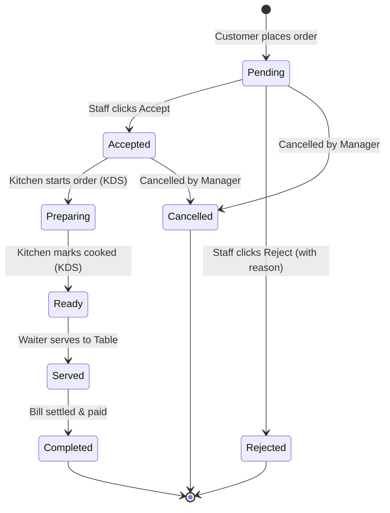

# 🏛️ System Architecture: Serve.AI Restaurant Ecosystem

## 1. Executive Summary

Serve.AI is an end-to-end, multi-tenant restaurant ordering and operations ecosystem designed for modern high-velocity restaurants. The architecture unites:
1. **Zero-install Customer QR Web Experience** (Mobile-first PWA, token-validated table ordering, live order tracking, GST tax invoicing).
2. **Real-time Staff POS Dashboard** (Instant order popups, audio chime alerts, AI voice speech announcements, order status state machine).
3. **Kitchen Display System (KDS)** (Touch-friendly 3-column kanban, color-coded SLA timers, bump bar actions).
4. **Restaurant Admin Operations Hub** (Multi-tenant menu management, table/QR generation & print sheets, staff RBAC, GST settings, revenue analytics).
5. **Flutter Mobile Application** (Native iOS/Android companion for on-the-floor waiters, managers, and kitchen staff with push notifications and native TTS).
6. **Supabase Core Backend** (PostgreSQL 15+, Row Level Security, Supabase Realtime WebSocket engine, Edge Functions, Storage buckets for food imagery).

---

## 2. Architecture Diagram

```mermaid
flowchart TD
    subgraph Customer [Customer Layer (Zero-Install)]
        QR[Unique Table QR Code with HMAC Token] --> WebApp[Customer Web App / PWA]
        WebApp --> Cart[Cart & Customisations]
        Cart --> OrderSubmit[Order Placement / Razorpay UPI]
        OrderSubmit --> Tracking[Live Order Tracking Timeline]
        Tracking --> Invoice[GST Digital Invoice / PDF]
    end

    subgraph Edge [Network & Edge Layer]
        CDN[CDN / Vercel Edge]
        EdgeFn[Supabase Edge Functions]
        EdgeFn --> CreateOrderFn[create-order]
        EdgeFn --> GenInvoiceFn[generate-invoice]
        EdgeFn --> WebhookFn[payment-webhook]
        EdgeFn --> QRGenFn[generate-table-qr]
    end

    subgraph Supabase [Supabase Backend & PostgreSQL]
        Auth[Supabase Auth / JWT]
        RLS[Row Level Security Engine]
        DB[(PostgreSQL 26+ Tables)]
        Realtime[Supabase Realtime WebSocket PubSub]
        Storage[Supabase Storage Buckets]
    end

    subgraph StaffApp [Staff Operations & Kitchen]
        StaffWeb[Staff Real-time Web Dashboard]
        KDS[Kitchen Display System - 3-Column]
        TTS[AI Voice Announcement Queue]
        AdminWeb[Admin Management & Analytics]
    end

    subgraph Mobile [Native Mobile App]
        FlutterApp[Flutter Staff / Owner App]
        FCM[Firebase Push Notifications]
        NativeTTS[Flutter TTS Engine]
    end

    WebApp -->|HTTPS / Supabase Client| DB
    OrderSubmit -->|Invoke| CreateOrderFn
    CreateOrderFn -->|Atomic Transaction & Validation| DB
    DB -->|Postgres CDC Trigger| Realtime
    Realtime -->|WebSocket Push| StaffWeb
    Realtime -->|WebSocket Push| KDS
    Realtime -->|WebSocket Push| FlutterApp
    Realtime -->|WebSocket Push| Tracking
    StaffWeb -->|Audio Engine| TTS
    FlutterApp -->|Native Audio| NativeTTS
    FCM -->|Push Notification| FlutterApp
```

---

## 3. Database & Security Schema

### 3.1 Key Tables Overview
1. `restaurants`: Multi-tenant organization profile, legal name, GSTIN, currency, branding.
2. `restaurant_settings`: Tax rules (CGST %, SGST %, IGST %), packaging fee, voice announcement preferences, auto-accept toggles.
3. `profiles`: Global user accounts linked with `auth.users`.
4. `restaurant_members`: Staff associations and RBAC roles (`owner`, `admin`, `manager`, `waiter`, `kitchen`, `cashier`).
5. `tables`: Dining tables (`T-01`, `T-02`, etc.), capacity, seating section, current active order reference.
6. `table_qr_tokens`: Cryptographic random tokens linked to each table. Prevents table spoofing.
7. `menu_categories`: Categories with display order and icon/image.
8. `menu_items`: Food items, base prices, veg/non-veg status, preparation time, availability, bestseller flag.
9. `menu_item_variants`: Size/portion variants (e.g. Regular ₹149, Medium ₹249, Large ₹349).
10. `menu_addons`: Addon options (e.g. Extra Cheese ₹40, Extra Toppings ₹30).
11. `item_addons`: Many-to-many relationship linking menu items with allowable addon groups.
12. `orders`: High-level order record, restaurant ID, table ID, order number (`ORD-1001`), status, payment status, subtotal, tax, discount, total.
13. `order_items`: Line items capturing selected variant, quantity, unit price snapshot.
14. `order_item_addons`: Addons attached to individual order items with pricing snapshots.
15. `order_status_history`: Audit trail tracking every state transition with timestamp and acting user/system.
16. `payments`: Payment records, provider reference (Razorpay/UPI), status, transaction ID.
17. `invoices`: Immutable snapshot of the bill upon order completion/payment.
18. `invoice_items`: Immutable line items on the tax invoice.
19. `notifications`: In-app notification queue for staff and admins.
20. `device_tokens`: FCM tokens for native mobile push notifications.
21. `announcement_logs`: Audio speech logs to ensure deduplication across tabs/devices.
22. `discounts`: Promotional vouchers, percentage/flat discounts.
23. `restaurant_hours`: Operating hours per day of the week.
24. `inventory`: Raw ingredient or dish-level stock tracking.
25. `audit_logs`: Sensitive operational change tracking (role modifications, refund triggers, price edits).

---

## 4. Order State Machine & Lifecycle



---

## 5. AI Voice Order Announcement Protocol

### Problem Statement:
When multiple staff devices or tabs are open, a naive websocket listener would trigger loud overlapping audio announcements multiple times simultaneously.

### Solution: Centralized Announcement Queue & Dedup Engine
1. **Deduplication Key**: Each order announcement is hashed with `order_id + event_type`.
2. **Audio Mutex / Lock**: Stored in `localStorage` / session memory with timestamp expiry (15s lock).
3. **Speech Synthesis Pipeline**:
   - Generates natural phonetic text:
     *"Attention staff! A new order has been received for Table {table_number}. Order number {order_number_digits}. {item_summary}. The total bill is {amount_words} rupees. Please accept and prepare the order."*
   - Uses Web Speech API `SpeechSynthesisUtterance` with Indian English (`en-IN`) or Hindi (`hi-IN`) voice profile.
   - Provides user-triggered Audio Unlocker to satisfy modern browser autoplay restrictions.
   - Fallback visual flash banner if audio is muted or blocked.

---

## 6. Indian GST & Decimal Financial Math

All calculations adhere strictly to the Indian GST composition / regular restaurant scheme:
- **Taxable Subtotal** = $\sum(\text{Base Item Price} + \text{Variant Surcharge} + \text{Addons}) \times \text{Qty} - \text{Discounts}$
- **CGST (Central GST)** = $\text{Taxable Subtotal} \times \frac{\text{CGST \%}}{100}$ (Default: 2.5%)
- **SGST (State GST)** = $\text{Taxable Subtotal} \times \frac{\text{SGST \%}}{100}$ (Default: 2.5%)
- **Packaging Charge** = Configurable per-order or per-item fee (for takeaway).
- **Grand Total** = $\text{Taxable Subtotal} + \text{CGST} + \text{SGST} + \text{Packaging Charges}$
- Rounded to the nearest integer for cash/UPI settlement.
- Snapshots are committed to `invoices` table to ensure historic auditability even if menu prices update later.

